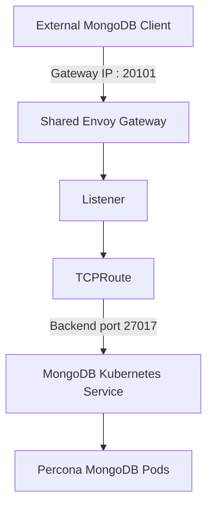
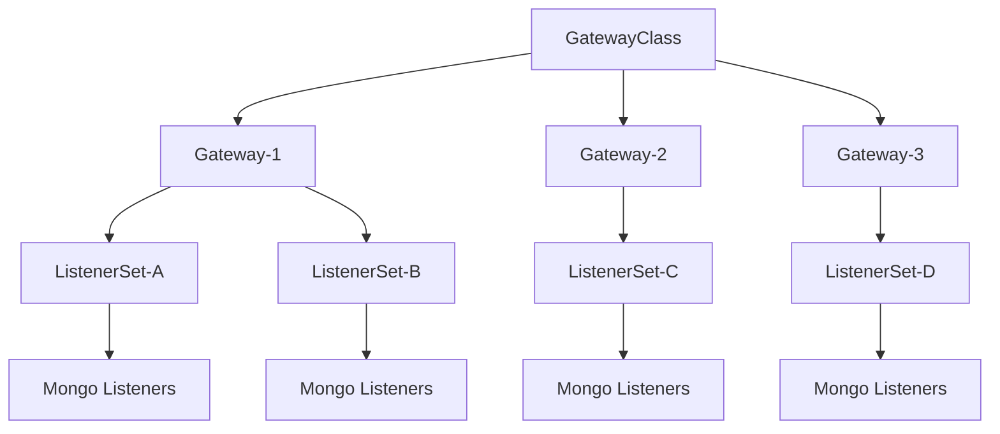

# Kubernetes Gateway API: Gateway, Listener, ListenerSet and TCPRoute

## 1. Overview

In our architecture, we have hundreds of Percona MongoDB clusters that need external TCP connectivity.

Instead of exposing every MongoDB cluster through an individual LoadBalancer, we use shared Envoy Gateways.

For example:

- 500 MongoDB clusters.
- 3 shared Envoy Gateways.
- Each MongoDB cluster needs a unique external TCP port.
- Incoming traffic must reach the correct MongoDB Kubernetes Service.

To understand this architecture, we need to understand four important resources:

1. GatewayClass
2. Gateway
3. Listener / ListenerSet
4. TCPRoute

---

## 2. GatewayClass

GatewayClass defines which Gateway controller manages Gateway resources.

For example, Envoy Gateway provides a controller that watches Gateway resources associated with its GatewayClass.

```yaml
apiVersion: gateway.networking.k8s.io/v1
kind: GatewayClass
metadata:
  name: envoy-gateway-class
spec:
  controllerName: gateway.envoyproxy.io/gatewayclass-controller
```

**Important points:**

- GatewayClass represents a class of Gateways.
- Multiple Gateway resources can reference the same GatewayClass.
- The controller responsible for that GatewayClass manages the corresponding Gateway infrastructure.

Relationship:

`One GatewayClass → Multiple Gateways`

---

## 3. Gateway

Gateway represents the actual shared entry point for incoming traffic.

It defines:

- Which GatewayClass manages it.
- Which addresses/interfaces are exposed.
- Which listeners accept incoming connections.

Example:

```yaml
apiVersion: gateway.networking.k8s.io/v1
kind: Gateway
metadata:
  name: shared-mongodb-gateway
spec:
  gatewayClassName: envoy-gateway-class
  listeners:
    - name: mongo-101
      port: 20101
      protocol: TCP
```

In this example:

- Gateway is the shared infrastructure.
- Listener accepts TCP traffic on port 20101.

A Gateway can contain multiple listeners.

### The configuration management problem

Imagine 500 MongoDB clusters requiring external TCP connectivity.

If every listener is configured directly inside the same Gateway resource:

- The Gateway resource becomes very large.
- Multiple controllers or teams may need to modify the same resource.
- Resource ownership becomes difficult.
- Concurrent updates can introduce conflicts.
- Reconciliation and lifecycle management become more complicated.

This is where ListenerSet becomes useful.

---

## 4. Listener

A Listener defines the entry point for incoming traffic.

It specifies:

- Port
- Protocol
- Hostname, where applicable
- Allowed routes

Example:

```yaml
listeners:
  - name: mongo-101
    port: 20101
    protocol: TCP
```

Conceptually:

> Accept incoming TCP connections on port 20101.

A Listener does not independently specify which MongoDB Service should receive the traffic.

That responsibility belongs to the Route.

---

## 5. ListenerSet

### What problem does ListenerSet solve?

ListenerSet allows additional listener configurations to be managed independently from the Gateway resource.

Instead of continuously modifying one shared Gateway YAML, different teams or controllers can manage separate ListenerSet resources.

Conceptual architecture:

```text
                 GatewayClass
                      |
                      |
                  Gateway-1
                      |
          +-----------+-----------+
          |           |           |
      ListenerSet-A  ListenerSet-B  ListenerSet-C
          |           |           |
       Listeners    Listeners    Listeners
```

For example:

- Team A manages ListenerSet-A.
- Team B manages ListenerSet-B.
- Gateway Operator manages Gateway-1.

Each ListenerSet attaches to one parent Gateway.

A Gateway can have multiple ListenerSets.

### Important clarification

ListenerSet does NOT allocate external ports or define an automatic port range.

Port allocation remains a separate responsibility.

For example:

```text
MongoDB cluster    External port
--------------------------------
mongo-101          20101
mongo-102          20102
mongo-103          20103
mongo-104          20104
```

The port allocation mechanism must:

1. Identify available ports.
2. Allocate a unique port.
3. Prevent duplicate allocations.
4. Associate the allocated port with the MongoDB cluster.

The controller must then create or update the appropriate ListenerSet with the actual listener configuration.

### Why not one ListenerSet per MongoDB cluster?

That is not mandatory.

A ListenerSet can contain multiple listeners. We can group listeners based on ownership, namespace and operational requirements.

---

## 6. TCPRoute

TCPRoute defines where incoming TCP traffic should be forwarded.

It connects a Listener to a backend Kubernetes Service.

Example:

```yaml
apiVersion: gateway.networking.k8s.io/v1alpha2
kind: TCPRoute
metadata:
  name: mongo-101-route
spec:
  parentRefs:
    - name: shared-mongodb-gateway
      sectionName: mongo-101

  rules:
    - backendRefs:
        - name: mongo-101-rs0
          port: 27017
```

There are two important sections.

### A. parentRefs

```yaml
parentRefs:
  - name: shared-mongodb-gateway
    sectionName: mongo-101
```

This tells Gateway API which Gateway listener the TCPRoute wants to attach to.

### B. backendRefs

```yaml
backendRefs:
  - name: mongo-101-rs0
    port: 27017
```

This identifies the Kubernetes Service that should receive the traffic.

In this example:

- External port: 20101
- Internal Service port: 27017

**Important distinction:**

Listener defines WHERE traffic enters.

TCPRoute defines WHERE traffic goes.

---

## 7. Listener vs TCPRoute

| Listener | TCPRoute |
|---|---|
| Defines the entry point | Defines the backend destination |
| Configures port and protocol | References a backend Service |
| Belongs to Gateway or ListenerSet | Attaches to a Gateway listener |
| Does not select MongoDB backend | Selects MongoDB backend |

For MongoDB connectivity:

```text
External Client
      |
      | Connects to Gateway-IP:20101
      |
      v
Gateway Listener
      |
      | TCP port 20101
      |
      v
TCPRoute
      |
      | Backend: mongo-101-rs0:27017
      |
      v
MongoDB Kubernetes Service
      |
      v
Percona MongoDB Pods
```

---

## 8. Relationship Between Resources

| Relationship | Explanation |
|---|---|
| One GatewayClass → Multiple Gateways | Multiple Gateways can use the same GatewayClass. |
| One Gateway → Multiple Listeners | Gateway can define multiple listeners directly. |
| One Gateway → Multiple ListenerSets | Multiple ListenerSets can attach to the same Gateway. |
| One ListenerSet → One Gateway | Each ListenerSet has one parent Gateway reference. |
| One Listener → Multiple TCPRoutes | Multiple compatible routes can attach to a listener. |
| One TCPRoute → Multiple Listeners | A TCPRoute can reference multiple compatible parent listeners. |

These are resource relationships, subject to route compatibility, listener acceptance and attachment policies.

---

## 9. Complete MongoDB Connectivity Flow

Consider a new MongoDB cluster named `mongo-101`.

### Step 1: MongoDB cluster creation

The user creates a Percona Server for MongoDB (PSMDB) Custom Resource.

### Step 2: Percona Operator

Percona Operator creates and manages:

- MongoDB Pods.
- StatefulSets.
- PVCs.
- Internal Kubernetes Services.

Percona is responsible for MongoDB lifecycle management, not allocating external ports for our shared Envoy Gateway architecture.

### Step 3: External port allocation

The Liberty port allocation mechanism allocates an available external port.

Example:

```text
mongo-101 → 20101
```

### Step 4: ListenerSet configuration

Liberty Gateway Operator creates or updates a ListenerSet with the corresponding TCP listener.

```text
Listener name: mongo-101
Protocol: TCP
Port: 20101
```

### Step 5: TCPRoute creation

Liberty Gateway Operator creates a TCPRoute.

```text
Parent: Gateway-1 / mongo-101
Backend: mongo-101-rs0:27017
```

### Step 6: Envoy Gateway reconciliation

Envoy Gateway processes the Gateway API resources and configures the underlying Envoy proxy.

### Step 7: External connectivity

An external MongoDB client connects to:

```text
<gateway-ip>:20101
```

Envoy receives the TCP connection and forwards it to the appropriate MongoDB Kubernetes Service.

---

## 10. Complete Architecture Diagram



### Resource Management Architecture



---

## 11. Key Takeaways

1. **GatewayClass:** Defines which controller manages the Gateway.
2. **Gateway:** Represents shared gateway infrastructure.
3. **Listener:** Defines the external port and protocol.
4. **ListenerSet:** Allows additional listener configuration to be independently managed without repeatedly modifying the shared Gateway resource.
5. **Port Allocation:** Allocates unique external ports; this is separate from ListenerSet.
6. **TCPRoute:** Connects incoming TCP traffic to the appropriate Kubernetes Service.
7. **Percona Operator:** Manages MongoDB infrastructure and internal Services.

### Most Important Concept

For our 500 MongoDB cluster use case:

- Port allocation determines the external port.
- ListenerSet defines the listener configuration.
- TCPRoute determines the backend Service.
- Envoy Gateway handles the actual incoming TCP traffic.

ListenerSet solves the listener configuration ownership and management problem. It does not replace port allocation or TCPRoute.
