# Kubernetes Gateway API – Understanding Envoy Gateway

A practical guide to Kubernetes Gateway API, Envoy Gateway, ListenerSets, TCPRoute, and custom Gateway Operators.

This document explains the concepts using a real-world architecture:

- 500 MongoDB clusters
- 3 shared Envoy Gateways
- Unique external TCP ports for each MongoDB cluster
- MongoDB listening internally on port `27017`
- A custom Liberty Gateway Operator managing port allocation and routing lifecycle

---

## Table of Contents

1. [Architecture Overview](#1-architecture-overview)
2. [Gateway API Resources vs Envoy Resources](#2-gateway-api-resources-vs-envoy-resources)
3. [GatewayClass – Why Do We Need It?](#3-gatewayclass--why-do-we-need-it)
4. [Gateway – What Problem Does It Solve?](#4-gateway--what-problem-does-it-solve)
5. [Listener vs ListenerSet](#5-listener-vs-listenerset)
6. [TCPRoute vs HTTPRoute](#6-tcproute-vs-httproute)
7. [Gateway Controller vs Custom Gateway Operator](#7-gateway-controller-vs-custom-gateway-operator)
8. [How Liberty Gateway Operator Fits In](#8-how-liberty-gateway-operator-fits-in)
9. [End-to-End Traffic Flow](#9-end-to-end-traffic-flow)
10. [Failure Handling and High Availability](#10-failure-handling-and-high-availability)
11. [Interview Questions and Answers](#11-interview-questions-and-answers)

---

## 1. Architecture Overview

Before understanding individual resources, let's understand the three main layers.

| Component | Responsibility |
|---|---|
| Kubernetes Gateway API | Defines desired networking configuration |
| Envoy Gateway | Implements Gateway API and generates Envoy configuration |
| Envoy Proxy | Receives and forwards actual network traffic |
| Liberty Gateway Operator | Implements company-specific automation and business logic |

### High-level architecture

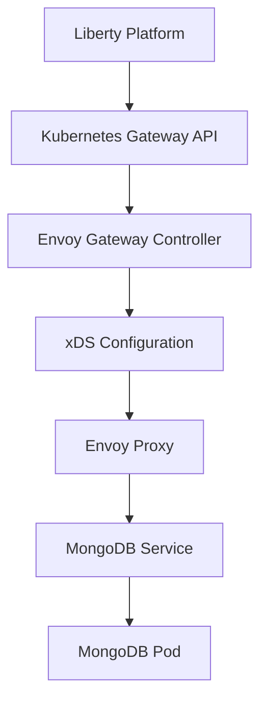

**Important distinction:**

- Gateway API describes WHAT we want.
- Envoy Gateway determines HOW to configure Envoy.
- Envoy Proxy handles the actual traffic.
- Liberty Gateway Operator automates company-specific requirements.

---

## 2. Gateway API Resources vs Envoy Resources

### What is Gateway API?

Gateway API is a collection of Kubernetes-native resources for managing traffic entering a Kubernetes cluster.

Examples:

- GatewayClass
- Gateway
- HTTPRoute
- TCPRoute
- ListenerSet
- ReferenceGrant

Instead of directly configuring Envoy, we describe our networking requirements using Kubernetes resources.

### What problem does it solve?

Without a standard abstraction, applications and platform automation can become tightly coupled to a specific proxy implementation.

Gateway API provides a standardized interface between platform teams and the underlying networking implementation.

For example:

```yaml
apiVersion: gateway.networking.k8s.io/v1
kind: Gateway
metadata:
  name: shared-gateway
spec:
  gatewayClassName: envoy
  listeners:
    - name: mongo
      protocol: TCP
      port: 30001
```

This describes our desired configuration.

However, Envoy Proxy doesn't understand Kubernetes Gateway YAML directly.

Envoy understands its own configuration model, delivered through APIs such as xDS.

### Gateway API to Envoy configuration mapping

| Gateway API | Conceptual Envoy configuration |
|---|---|
| Gateway Listener | Envoy Listener (LDS) |
| HTTPRoute | HTTP route configuration (RDS) |
| TCPRoute | TCP proxy filter and upstream configuration |
| Backend Service | Envoy Cluster (CDS) |
| Service endpoints | Envoy endpoints (EDS) |

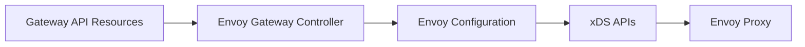

### Questions and Answers

**Q: Why can't we directly configure Envoy?**

We can, but that tightly couples our platform automation to Envoy-specific configuration. Gateway API provides a Kubernetes-native abstraction.

**Q: Does Gateway API configure Envoy by itself?**

No. Gateway API defines the desired configuration. A Gateway controller implements it.

**Q: Does Gateway API handle actual network traffic?**

No. Envoy Proxy handles actual traffic.

**Remember:** Gateway API describes what we want; Envoy Gateway translates that requirement into Envoy configuration.

---

## 3. GatewayClass – Why Do We Need It?

### What is GatewayClass?

GatewayClass identifies which Gateway controller is responsible for implementing a Gateway.

Example:

```yaml
apiVersion: gateway.networking.k8s.io/v1
kind: GatewayClass
metadata:
  name: envoy
spec:
  controllerName: gateway.envoyproxy.io/gatewayclass-controller
```

### What problem does it solve?

Imagine Kubernetes supports multiple Gateway implementations:

- Envoy Gateway
- Istio
- NGINX Gateway Fabric
- Other Gateway API implementations

When someone creates a Gateway, how does Kubernetes know which controller should manage it?

GatewayClass solves this problem.

It establishes the relationship between a Gateway and its implementing controller.

### Comparison with StorageClass

Think about Kubernetes StorageClass:

```text
StorageClass
     |
     v
Storage Provisioner
     |
     v
Storage Infrastructure
```

Similarly:

```text
GatewayClass
     |
     v
Gateway Controller
     |
     v
Gateway Infrastructure
```

The analogy is useful, although the responsibilities aren't identical.

### How does it fit into our architecture?

We define an Envoy GatewayClass.

Our three shared Gateway resources reference this class.

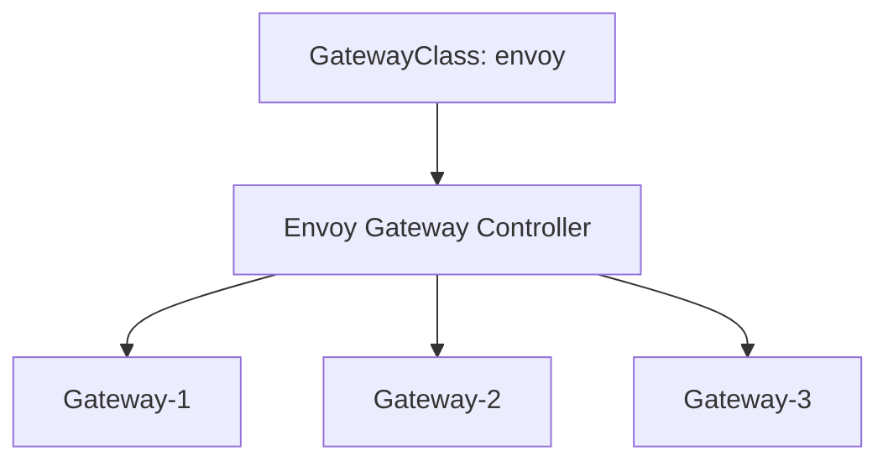

### Questions and Answers

**Q: Why can't we directly specify Envoy inside the Gateway resource?**

GatewayClass separates the implementation choice from individual Gateway configuration.

**Q: Can we have multiple GatewayClasses?**

Yes. Different GatewayClasses can refer to different Gateway controllers or configurations.

**Q: Does GatewayClass create Envoy Proxy pods?**

GatewayClass identifies the responsible controller. The controller manages the infrastructure associated with individual Gateways.

**Remember:** GatewayClass answers WHO is responsible for implementing a Gateway.

---

## 4. Gateway – What Problem Does It Solve?

### What is Gateway?

Gateway represents a traffic entry point managed by a Gateway controller.

It defines:

- Which GatewayClass implements it.
- Which ports should accept traffic.
- Which protocols are supported.
- Which routes can attach to it.
- TLS configuration, where applicable.

Example:

```yaml
apiVersion: gateway.networking.k8s.io/v1
kind: Gateway
metadata:
  name: shared-gateway-1
spec:
  gatewayClassName: envoy
  listeners:
    - name: mongo
      protocol: TCP
      port: 30001
```

### What problem does it solve?

GatewayClass tells us which implementation manages a Gateway.

But it doesn't define the actual traffic entry point.

Gateway defines the desired network configuration.

For example:

- GatewayClass says Envoy Gateway manages this Gateway.
- Gateway says listen on port 30001 using TCP.

### Our architecture

We have three shared Gateways:

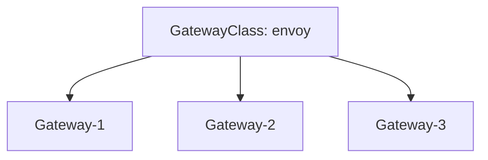

These Gateways provide shared entry points rather than creating one Gateway per MongoDB cluster.

A Gateway resource is not necessarily one Envoy Proxy pod. Envoy Gateway can manage multiple proxy replicas behind the Gateway infrastructure.

### Questions and Answers

**Q: Why not create one Gateway per MongoDB cluster?**

That could result in unnecessary infrastructure duplication, additional load balancers, proxy deployments and operational overhead.

Shared Gateways allow multiple MongoDB clusters to use common infrastructure.

**Q: Can one Gateway serve multiple applications?**

Yes. A Gateway can support multiple listeners and attached routes, subject to implementation and attachment constraints.

**Q: Does Gateway itself forward traffic?**

No. It describes the desired entry point. Envoy Proxy handles traffic.

**Remember:** Gateway answers WHERE and HOW traffic should enter our infrastructure.

---

## 5. Listener vs ListenerSet

This is particularly important for our 500 MongoDB cluster architecture.

### 5.1 Listener

A Listener defines how a Gateway accepts incoming traffic.

It specifies:

- Port
- Protocol (HTTP, HTTPS, TCP, TLS)
- Hostname, where applicable
- TLS configuration
- AllowedRoutes

Example:

```yaml
listeners:
  - name: mongo-30001
    protocol: TCP
    port: 30001

  - name: mongo-30002
    protocol: TCP
    port: 30002
```

Both listeners belong to the same Gateway.

### What problem does Listener solve?

Gateway defines a traffic entry point, but it needs to know which ports and protocols to accept.

Listener defines those entry points.

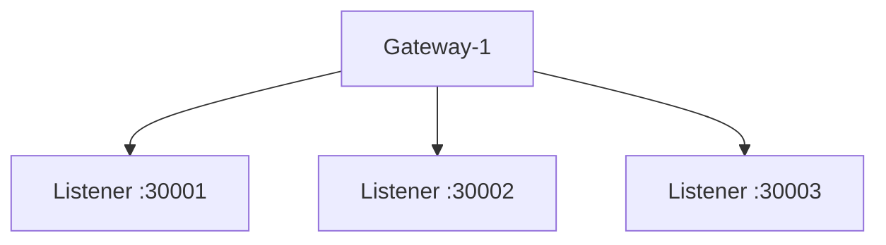

### 5.2 ListenerSet

ListenerSet allows additional listeners to be defined separately from the Gateway resource and attached to an existing Gateway.

### What problem does ListenerSet solve?

Imagine hundreds of MongoDB clusters need external connectivity.

Should every controller or team continuously modify the same Gateway YAML to add more listeners?

This can create:

- Shared configuration bottlenecks.
- Ownership conflicts.
- Difficult resource lifecycle management.
- Operational complexity.

ListenerSet allows additional listener configuration to be managed independently.

### Conceptual architecture

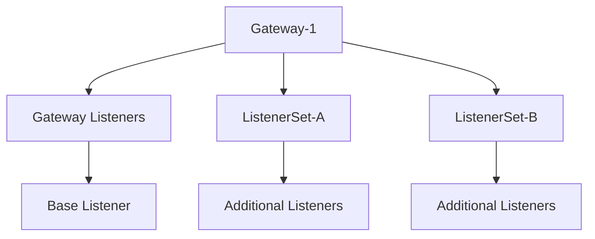

### ListenerSet use cases

1. **Separation of ownership:** Different teams or controllers can manage additional listeners.
2. **Independent lifecycle:** Listener configuration can be created, updated and deleted independently.
3. **Configuration scalability:** Avoid maintaining an unnecessarily large Gateway specification.
4. **Multi-team management:** Platform team owns the Gateway while authorized teams manage additional listeners.

### How it fits into our architecture

Our Liberty Gateway Operator could manage ListenerSets for MongoDB clusters.

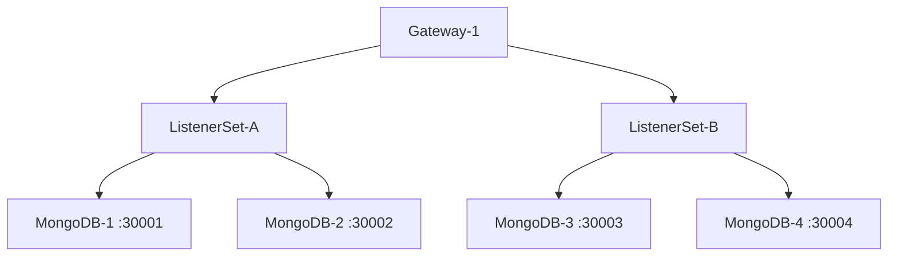

This is a conceptual ownership arrangement. Actual attachment permissions and ListenerSet API rules must be followed.

### Questions and Answers

**Q: Why not add all listeners directly to Gateway?**

We can. But with hundreds of listeners and multiple controllers or teams managing them, Gateway becomes a shared configuration bottleneck.

ListenerSet provides independent listener ownership and lifecycle management.

**Q: Does ListenerSet eliminate Envoy listener limits?**

No. It organizes configuration but does not remove underlying Envoy or implementation-specific listener limits.

**Q: Does ListenerSet allocate ports automatically?**

No. Your Liberty Gateway Operator must implement port allocation and conflict prevention.

**Q: Can multiple ListenerSets attach to one Gateway?**

Yes, subject to Gateway API support, attachment permissions and listener compatibility rules.

**Remember:** Listener defines an entry point. ListenerSet allows additional entry points to be managed independently of the Gateway resource.

---

## 6. TCPRoute vs HTTPRoute

A Route defines how incoming traffic reaches its backend.

Gateway defines WHERE traffic enters.

Route defines WHERE that traffic should go.

HTTP and TCP have different routing requirements, which is why Gateway API provides different route types.

### 6.1 HTTPRoute – Layer 7

HTTPRoute is used for HTTP/HTTPS traffic.

It can route based on:

- Hostname
- URL path
- HTTP headers
- HTTP methods

Example:

```yaml
apiVersion: gateway.networking.k8s.io/v1
kind: HTTPRoute
metadata:
  name: application-route
spec:
  parentRefs:
    - name: shared-gateway
  hostnames:
    - api.example.com
  rules:
    - matches:
        - path:
            type: PathPrefix
            value: /users
      backendRefs:
        - name: user-service
          port: 8080
```

### What problem does HTTPRoute solve?

Suppose we have 100 microservices behind one shared Gateway.

We don't want to expose a separate load balancer for every application.

HTTPRoute allows routing based on hostnames and paths.

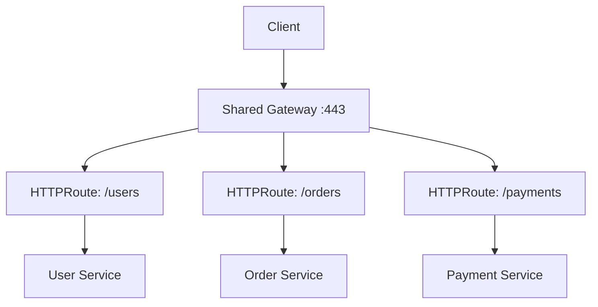

### 6.2 TCPRoute – Layer 4

TCPRoute is used for raw TCP traffic.

This is particularly relevant for MongoDB.

MongoDB clients establish TCP connections. They don't send HTTP requests with URL paths or HTTP headers.

Example:

```yaml
apiVersion: gateway.networking.k8s.io/v1alpha2
kind: TCPRoute
metadata:
  name: mongodb-route
spec:
  parentRefs:
    - name: shared-gateway
      sectionName: mongo-30001
  rules:
    - backendRefs:
        - name: mongodb-service
          port: 27017
```

### What problem does TCPRoute solve?

Suppose we have 500 MongoDB clusters.

We want clients to connect to the correct MongoDB cluster without the Gateway needing to understand the MongoDB application protocol.

TCPRoute provides the Layer 4 routing abstraction.

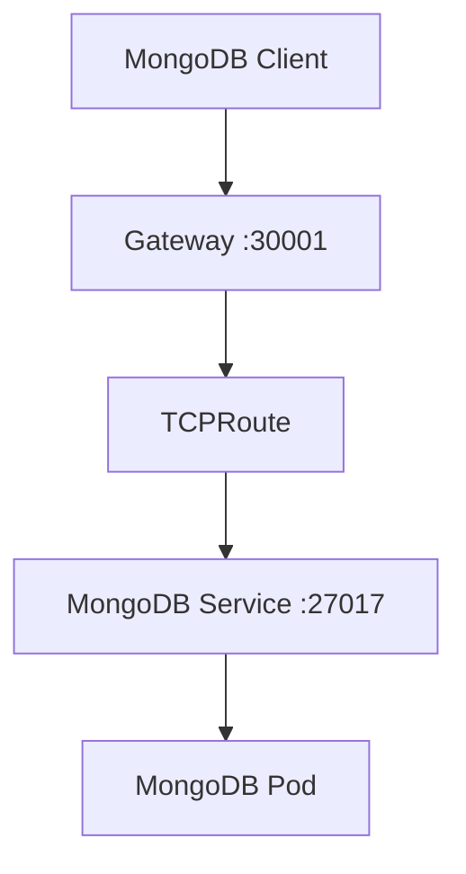

### Comparison

| Feature | HTTPRoute | TCPRoute |
|---|---|---|
| Layer | L7 | L4 |
| Protocol | HTTP/HTTPS | TCP |
| URL path matching | Yes | No |
| HTTP headers | Yes | No |
| Backend Service | Yes | Yes |
| Raw MongoDB TCP | Not appropriate | Appropriate |

### Questions and Answers

**Q: Why can't we use HTTPRoute for MongoDB?**

MongoDB uses its own protocol over TCP, not HTTP. HTTPRoute expects HTTP traffic and HTTP routing semantics.

**Q: Can TCPRoute inspect MongoDB requests?**

No. It provides TCP-level routing, not MongoDB-aware query routing.

**Q: How does TCPRoute know which Gateway listener to use?**

Through `parentRefs`, optionally identifying a specific listener using `sectionName`.

**Q: Does TCPRoute allocate an external port?**

No. The Listener defines the port. TCPRoute attaches to that Listener and defines the backend.

**Remember:** Listener accepts traffic; TCPRoute or HTTPRoute tells the Gateway where to forward it.

> Note: TCPRoute is an experimental Gateway API resource in the `v1alpha2` API version used in this example. Verify compatibility with your installed Gateway API CRDs and Envoy Gateway version.

---

## 7. Gateway Controller vs Custom Gateway Operator

This is one of the most important architectural distinctions.

An Operator is also a Kubernetes controller. Both use reconciliation loops.

The distinction is primarily their responsibilities.

### 7.1 Envoy Gateway Controller

It is the generic Gateway API implementation provided by the Envoy Gateway project.

It watches standard resources:

```text
GatewayClass
Gateway
HTTPRoute
TCPRoute
ListenerSet
```

### What problem does it solve?

Kubernetes understands Gateway API resources, but Envoy Proxy doesn't understand Kubernetes Gateway YAML.

We need an implementation that translates these resources into Envoy configuration.

Envoy Gateway Controller solves this problem.

Its responsibilities:

1. Watch Gateway API resources.
2. Validate resource relationships and route attachment.
3. Build the desired Envoy configuration.
4. Generate xDS resources.
5. Deliver configuration to Envoy Proxy.
6. Update resource status.

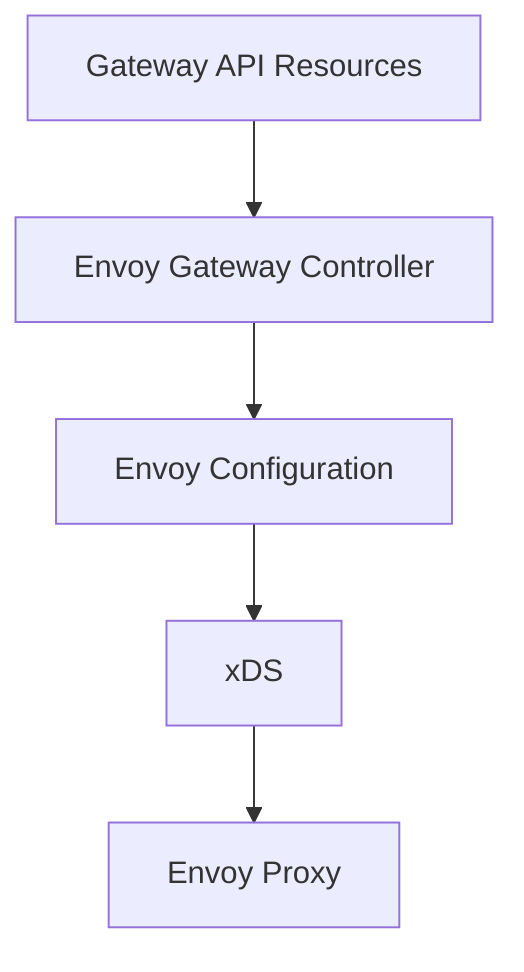

It doesn't need to understand MongoDB business requirements.

For example, it doesn't need to know:

- What a Liberty MongoDB cluster is.
- How our company allocates ports.
- Which MongoDB cluster belongs to which customer.

### 7.2 Liberty Gateway Operator

This is our company-specific Kubernetes controller.

It understands Liberty-specific requirements.

For example:

- MongoDB cluster lifecycle.
- Gateway selection.
- Port allocation.
- Port conflict prevention.
- TCPRoute creation.
- ListenerSet management.
- Port release during cluster deletion.

### What problem does it solve?

Envoy Gateway knows how to configure Envoy, but it doesn't know our company's business rules.

For example, when a new MongoDB cluster is created:

- Which Gateway should host it?
- Which external port should it receive?
- How do we ensure the port isn't already allocated?
- Which TCPRoute should be created?

These are Liberty-specific responsibilities.

### Comparison

| Responsibility | Liberty Gateway Operator | Envoy Gateway Controller |
|---|---|---|
| Understand MongoDB clusters | Yes | No |
| Allocate unique ports | Yes | No |
| Select shared Gateway | Yes | No |
| Create TCPRoute | Yes | No |
| Understand Gateway API | Uses it | Implements it |
| Generate Envoy xDS | No | Yes |
| Configure Envoy listeners | Indirectly | Yes |
| Handle actual traffic | No | No |

### Questions and Answers

**Q: Why do we need our own Gateway Operator when Envoy Gateway already exists?**

Envoy Gateway provides generic Gateway API implementation. It doesn't implement our company-specific MongoDB port allocation and lifecycle requirements.

We need our own operator to automate those business requirements.

**Q: Can our custom operator directly configure Envoy?**

Technically, it could use Envoy-specific APIs, but that would tightly couple business logic to Envoy.

A cleaner architecture is to create standard Gateway API resources and let Envoy Gateway handle Envoy-specific configuration.

**Q: Are both operators Kubernetes controllers?**

Yes. Both watch resources and reconcile desired state.

The difference is what they watch and what responsibilities they implement.

**Remember:** Liberty Operator manages business logic. Envoy Gateway manages networking implementation.

---

## 8. How Liberty Gateway Operator Fits In

Let's combine everything using our actual architecture.

### Problem statement

We have:

- 500 MongoDB clusters.
- 3 shared Envoy Gateways.
- Each MongoDB cluster needs external TCP connectivity.
- Each cluster requires a unique external port.
- MongoDB internally listens on port 27017.

We don't want engineers manually creating Gateway resources, allocating ports and creating routes every time a MongoDB cluster is provisioned.

We want this process automated.

### Step 1: MongoDB cluster gets created

Our existing Liberty MongoDB Operator provisions:

```text
mongodb-cluster-123
```

### Step 2: Gateway Operator identifies the requirement

Our Liberty Gateway Operator identifies that this cluster requires external connectivity.

It creates or reconciles a custom resource:

```yaml
apiVersion: gateway.liberty.example.com/v1
kind: GatewayPortAllocation
metadata:
  name: mongodb-cluster-123
spec:
  clusterName: mongodb-cluster-123
```

### Step 3: Allocate a port and select Gateway

Our custom operator checks existing allocations.

Example:

```text
MongoDB cluster: mongodb-cluster-123
Gateway:         shared-gateway-1
External port:   30001
Internal port:   27017
```

It ensures the port is available on that Gateway.

### Step 4: Create Gateway API resources

Our operator creates or updates the required resources.

Depending on the implementation, listeners may be managed through Gateway or ListenerSet.

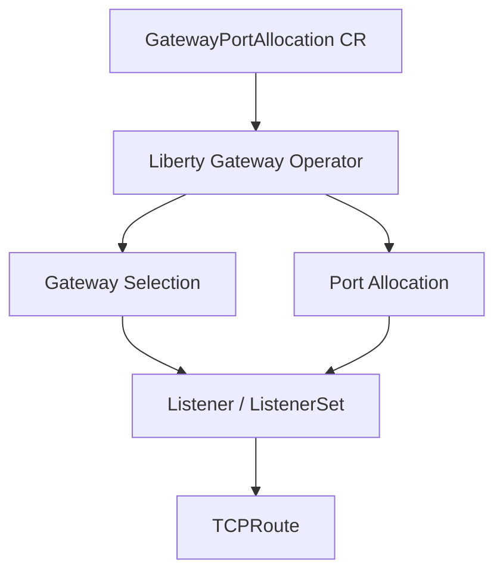

Example:

```text
Gateway:  shared-gateway-1
Listener: mongo-30001
TCPRoute: mongodb-cluster-123
Backend:  mongodb-service:27017
```

### Step 5: Envoy Gateway Controller takes over

It watches the newly created Gateway API resources.

It understands:

- Which Gateway should receive traffic.
- Which listener should accept connections.
- Which TCPRoute should be attached.
- Which Kubernetes Service is the backend.

It translates this desired state into Envoy configuration and delivers it using xDS.

### Step 6: Envoy Proxy receives configuration

Conceptually:

```text
Incoming port: 30001
       |
       v
TCP Proxy
       |
       v
Upstream:
mongodb-service:27017
```

### Step 7: Client connects

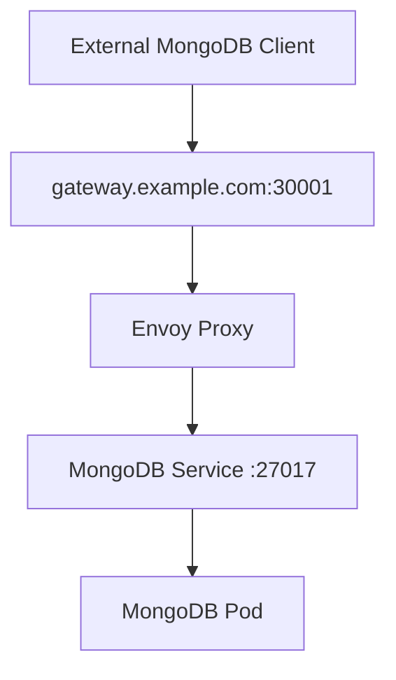

---

## 9. End-to-End Traffic Flow

This is the complete architecture to remember.

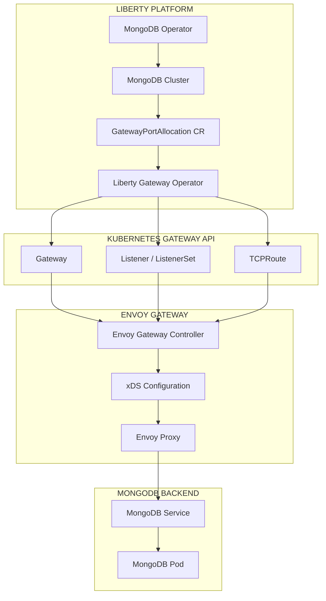

### Responsibility summary

| Component | Main responsibility |
|---|---|
| MongoDB Operator | Creates and manages MongoDB clusters |
| GatewayPortAllocation CR | Tracks desired external connectivity and allocation |
| Liberty Gateway Operator | Selects Gateway, allocates port and manages Gateway API resources |
| GatewayClass | Identifies the Gateway implementation |
| Gateway | Defines the traffic entry point |
| Listener / ListenerSet | Defines and manages listening ports |
| TCPRoute | Defines TCP backend routing |
| Envoy Gateway Controller | Translates Gateway API into Envoy configuration |
| Envoy Proxy | Handles actual traffic |
| MongoDB Service | Provides access to MongoDB Pods |

---

## 10. Failure Handling and High Availability

Consider this scenario:

Gateway-1 currently hosts 200 MongoDB clusters and suddenly becomes unavailable.

What should happen?

First, distinguish two failure scenarios.

### Scenario A: One Envoy Proxy pod fails

Suppose Gateway-1 has three Envoy Proxy replicas.

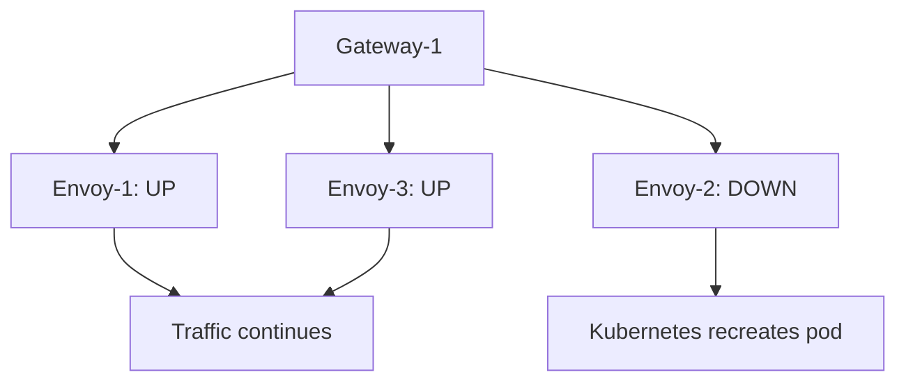

In this case:

- Kubernetes recreates the failed pod.
- The Service sends new connections to healthy endpoints.
- Existing connections on the failed pod may disconnect.
- Clients reconnect using retry logic.

We don't need to reallocate 200 MongoDB clusters.

### Scenario B: Entire Gateway infrastructure fails

Now imagine all three replicas fail.

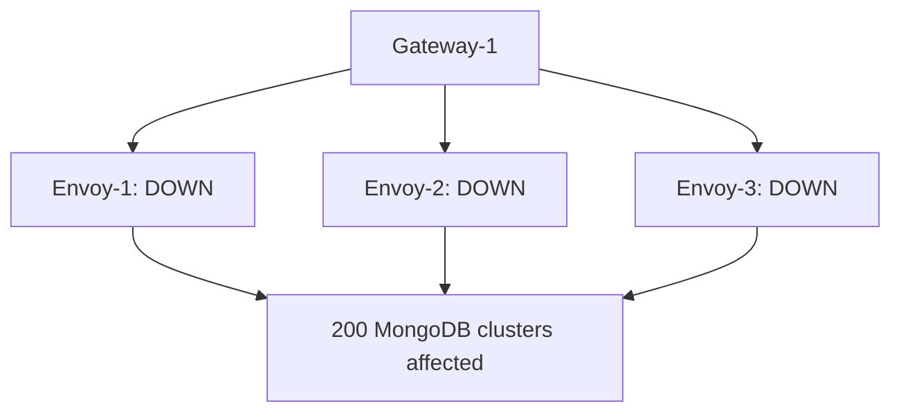

We need a failover strategy.

One possible approach is reserved capacity on Gateway-2 and Gateway-3.

| Gateway | Normal allocation | Failover capacity |
|---|---:|---:|
| Gateway-1 | 200 | 0 |
| Gateway-2 | 150 | 100 |
| Gateway-3 | 150 | 100 |

If Gateway-1 fails:

| Gateway | New allocation |
|---|---:|
| Gateway-1 | 0 |
| Gateway-2 | 250 |
| Gateway-3 | 250 |

This assumes sufficient CPU, memory, network and listener capacity.

### How does Liberty Gateway Operator help?

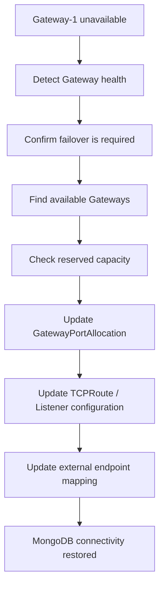

### Important considerations

1. Port allocation must remain consistent.
2. Port conflicts must be prevented.
3. Failover must be coordinated to avoid duplicate routing.
4. Existing TCP connections cannot be transparently migrated.
5. Clients need reconnection logic.
6. Stable DNS or an external load-balancing strategy is required if clients should retain the same endpoint.
7. Multiple operator replicas need safe coordination when allocating ports.

**Important:** ListenerSet does not provide automatic failover. The platform needs to implement its own health detection, capacity planning and recovery logic.

---

## 11. Interview Questions and Answers

### Q1. Why do we need Gateway API when Kubernetes already has Ingress?

Gateway API provides a more expressive and extensible networking model, with separate resources for infrastructure, listeners and routes. It also supports richer routing and clearer role separation.

### Q2. Why do we need GatewayClass?

It identifies which Gateway controller is responsible for implementing a Gateway.

### Q3. What is the difference between Gateway and GatewayClass?

GatewayClass identifies the implementation. Gateway defines the desired traffic entry point managed by that implementation.

### Q4. Why do we need ListenerSet?

It allows additional listeners to be defined and managed independently of the Gateway resource. It helps with configuration ownership and lifecycle management.

### Q5. Does ListenerSet eliminate Envoy listener limits?

No. It organizes configuration but doesn't remove underlying Envoy or implementation-specific limits.

### Q6. Why do we need TCPRoute instead of HTTPRoute for MongoDB?

MongoDB uses raw TCP rather than HTTP. TCPRoute provides Layer 4 routing to the appropriate backend.

### Q7. Who allocates the external MongoDB port?

Our Liberty Gateway Operator. Neither Gateway API nor Envoy Gateway automatically implements our company-specific allocation policy.

### Q8. Who translates Gateway API resources into Envoy configuration?

Envoy Gateway Controller. It generates the required Envoy configuration and delivers it through xDS.

### Q9. Does Envoy Gateway Controller handle incoming network traffic?

No. Envoy Proxy handles actual network traffic. Envoy Gateway Controller manages its configuration.

### Q10. Why do we need a custom Gateway Operator?

To automate Liberty-specific requirements such as MongoDB Gateway selection, port allocation, route creation and resource cleanup.

### Q11. What happens if a Gateway becomes unavailable?

The platform needs a failure detection and recovery strategy. Our custom operator can coordinate reassignment, provided capacity and routing constraints permit it. Existing TCP connections may disconnect and require client reconnection.

---

## Final Takeaways

| Concept | Remember it as |
|---|---|
| Gateway API | Standard Kubernetes networking abstraction |
| GatewayClass | Who implements the Gateway? |
| Gateway | Where does traffic enter? |
| Listener | Which port and protocol should accept traffic? |
| ListenerSet | How can additional listeners be managed independently? |
| HTTPRoute | How should HTTP traffic be routed? |
| TCPRoute | How should raw TCP traffic be routed? |
| Envoy Gateway Controller | How do we translate Gateway API into Envoy configuration? |
| Liberty Gateway Operator | How do we automate our company-specific requirements? |
| Envoy Proxy | Who actually handles network traffic? |

### The most important architectural idea

**Liberty Gateway Operator manages business logic. Envoy Gateway manages the generic networking implementation. Envoy Proxy handles the actual traffic.**

This separation makes the architecture easier to maintain, extend and evolve without coupling MongoDB lifecycle management directly to Envoy internals.

---

## Further Reading

- [Kubernetes Gateway API](https://gateway-api.sigs.k8s.io/)
- [Gateway API Concepts](https://gateway-api.sigs.k8s.io/concepts/api-overview/)
- [Gateway API Specifications](https://gateway-api.sigs.k8s.io/api-types/gateway/)
- [Envoy Gateway Documentation](https://gateway.envoyproxy.io/)
- [Envoy xDS Protocol](https://www.envoyproxy.io/docs/envoy/latest/api-docs/xds_protocol)
- [Kubernetes Operator Pattern](https://kubernetes.io/docs/concepts/extend-kubernetes/operator/)
